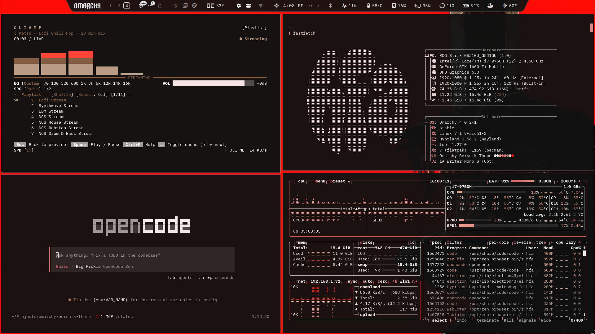
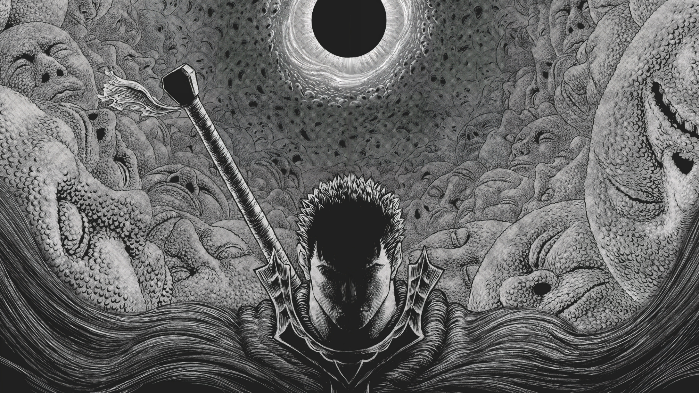
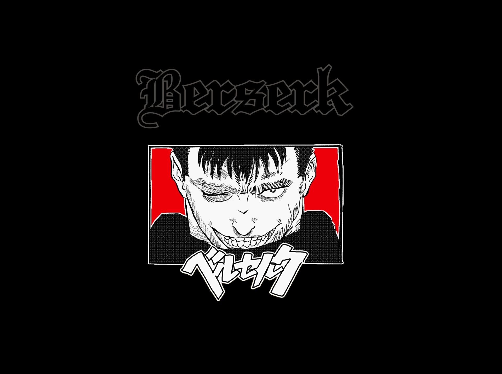
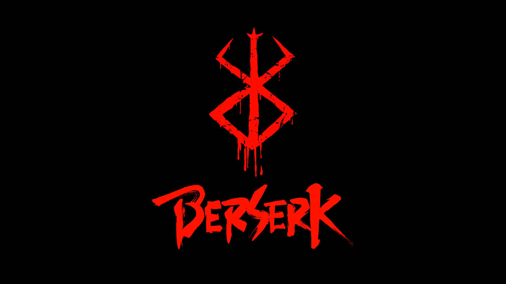
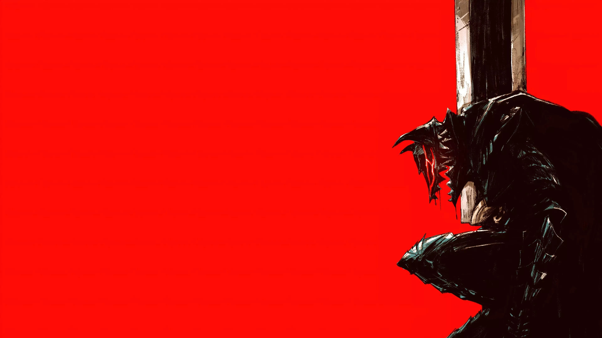
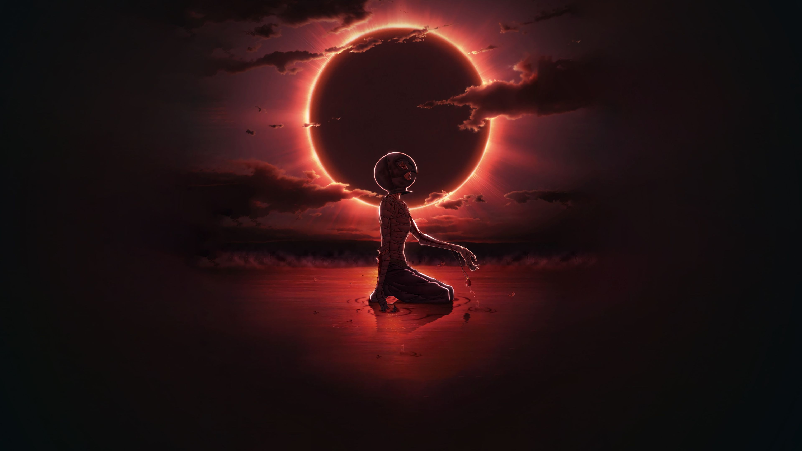
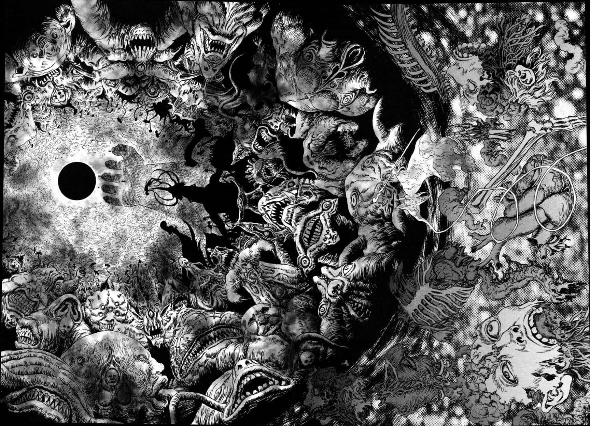

## Berserk

> "Struggle, endure, contend, and resist."

A dark, blood-accented theme for [Omarchy](https://omarchy.org), inspired by the Berserk manga.



## Install

```bash
omarchy theme install https://github.com/Hfanes/omarchy-berserk-theme
```

## Wallpapers

<div align="center">
  
  
  
  
  
  
</div>

## Credits

- Built on Omarchy's theme system by DHH and the Omarchy community.
- Wallpapers sourced from: `<site1>`, `<site2>`, `<site3>`. Original artists unknown; if yours is here, open an issue and I'll credit or remove it.
- _Berserk_ © Kentaro Miura, Hakusensha, Studio Gaga. This is an unofficial fan theme.

## License

MIT
